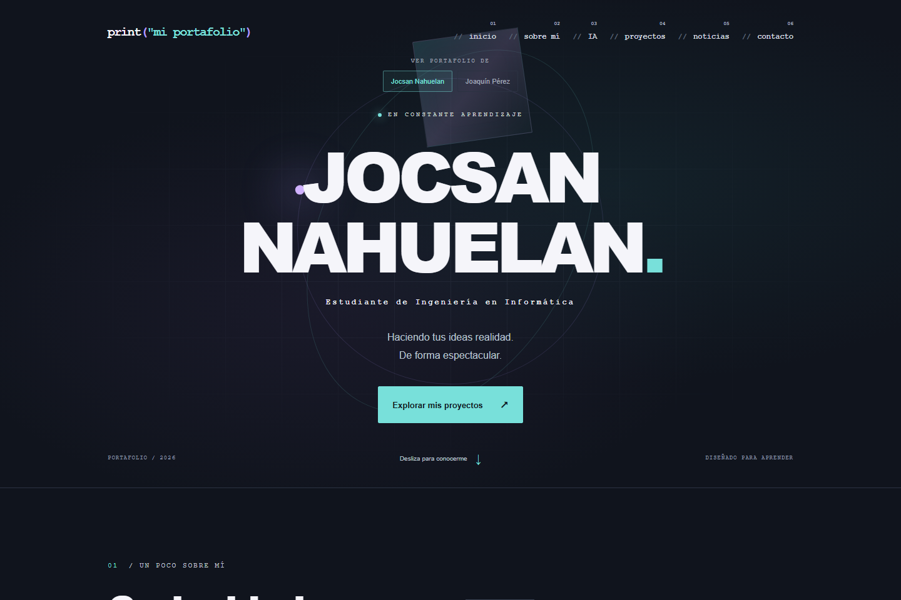
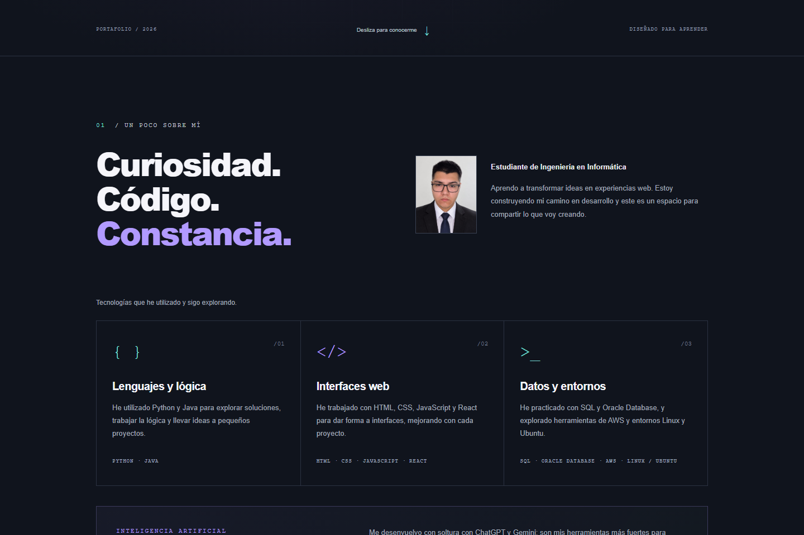
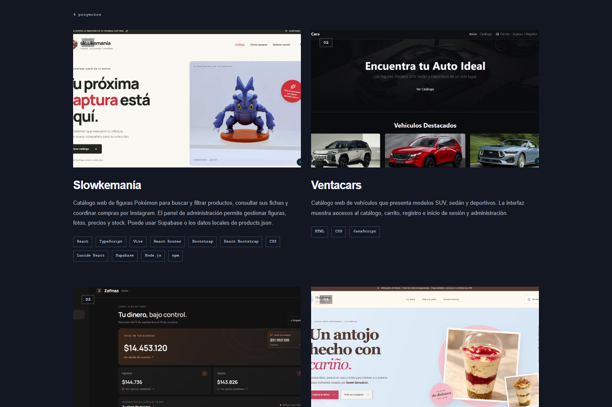
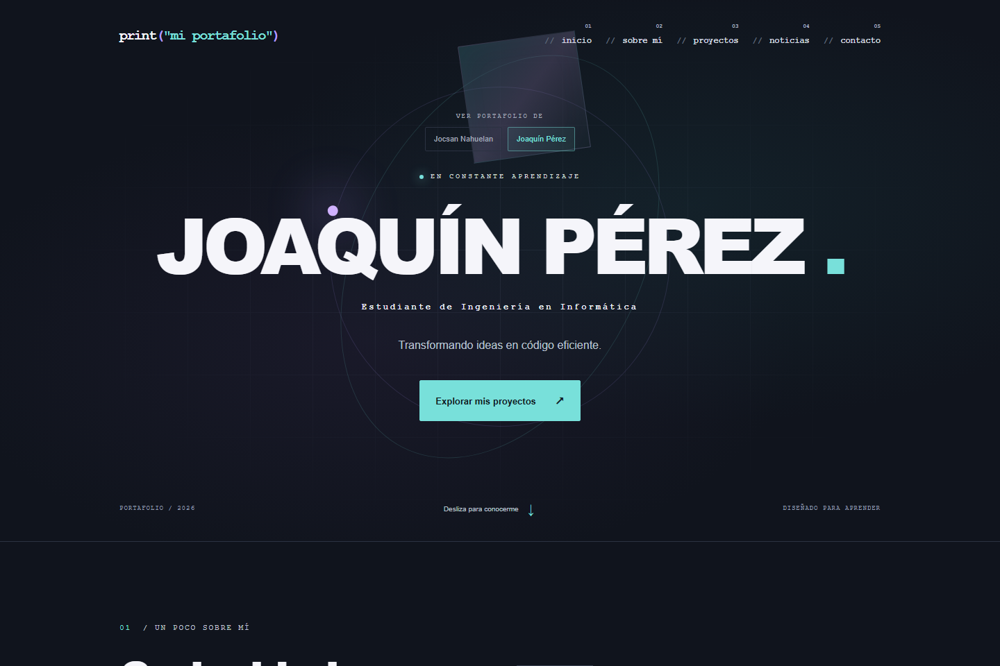
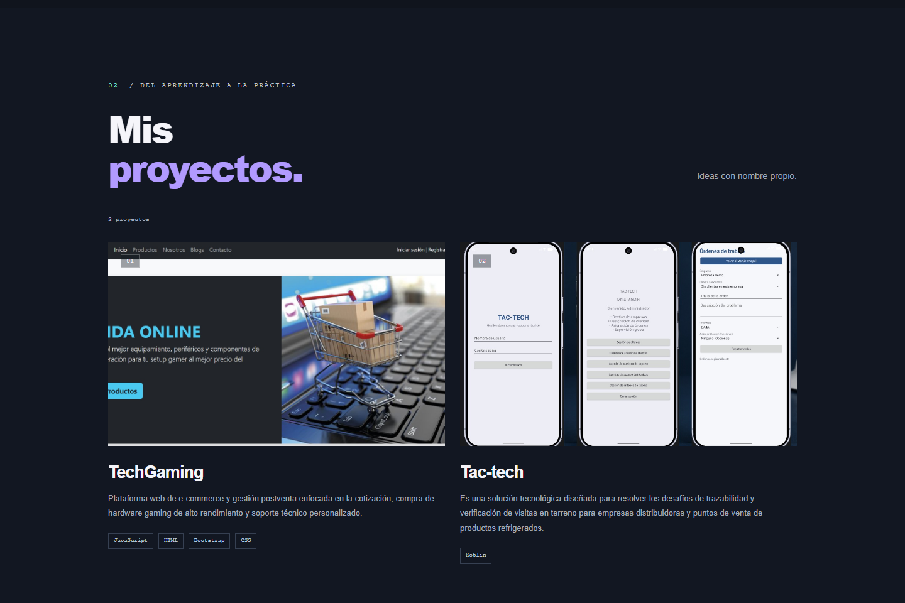

# Portafolio compartido

Aplicación web desarrollada con React para presentar dos perfiles de forma independiente. Cada perfil reúne su biografía, tecnologías, proyectos, noticias y medios de contacto.

## Documentos de la evaluación

- [Informe técnico del proyecto](docs/INFORME-TECNICO-PORTAFOLIO.pdf): describe la interfaz, la estructura de componentes, el flujo de datos, ejemplos de código, las pruebas, la cobertura y los puntos pendientes.
- [Presentación](docs/PRESENTACION-EVALUACION-FORMATIVA-2-8-DIAPOSITIVAS-FINAL.pptx): ocho diapositivas con capturas, proyectos, Atomic Design, código, pruebas y pendientes.
- [Plan de pruebas](docs/PLAN-DE-PRUEBAS.md): casos aprobados, alcance de cobertura y escenarios pendientes.

## Funcionalidades

- Selector de perfiles.
- Presentación personal con fotografía y biografía.
- Tecnologías utilizadas y sección opcional de inteligencia artificial.
- Tarjetas de proyectos con imágenes, descripciones, tecnologías y enlaces.
- Filtros de proyectos según sus categorías.
- Noticias personales y notas de aprendizaje.
- Enlaces a GitHub, Instagram, Facebook, Gmail, LinkedIn y Spotify.
- Formulario con validación local.
- Diseño adaptable a escritorio y dispositivos móviles.

El formulario valida los datos en el navegador; no envía correos ni almacena mensajes.

## Capturas de pantalla

La página permite alternar entre los dos perfiles. Las capturas siguientes muestran la presentación, la biografía, las tecnologías y la sección de proyectos.











La captura de cobertura se encuentra en `docs/evidencias/cobertura.png` y el desglose de los casos, resultados y pendientes está en `docs/PLAN-DE-PRUEBAS.md`.

## Tecnologías

React, Vite, JavaScript, Bootstrap, CSS y ESLint.

## Instalación

Requisitos: Node.js y npm.

```powershell
npm install
```

## Ejecución

```powershell
npm run dev
```

Abre la dirección indicada en la terminal, normalmente http://localhost:5173/.

## Compilación

```powershell
npm run build
npm run preview
```

La versión compilada se genera en la carpeta `dist`.

## Pruebas

```powershell
# Pruebas unitarias con JSDOM
npm run test -- --run

# Instalar Chromium la primera vez
npx playwright install chromium

# Pruebas de interfaz en Chromium
npm run test:browser

# Generar el informe de cobertura
npm run test:coverage
```

El informe HTML de cobertura queda en `coverage/index.html`.

Para ejecutar las pruebas de navegador, Playwright necesita Chromium instalado. Si el navegador no está instalado en el equipo:

```powershell
npx playwright install chromium
```

El resumen técnico, el alcance de la cobertura y los criterios pendientes están en `docs/AVANCES.md` y `docs/PLAN-DE-PRUEBAS.md`.

## Estructura

```text
src/
├── components/
│   ├── atoms/
│   ├── molecules/
│   ├── organisms/
│   └── templates/
├── data/
│   ├── jocsan.json
│   ├── compañero.json
│   └── perfiles.js
├── pages/
├── App.jsx
├── main.jsx
└── styles.css

public/
└── images/
    ├── jocsan/
    └── compañero/
```

Los componentes siguen una organización de Atomic Design: átomos, moléculas, organismos, plantillas y páginas.

## Personalización

Los datos de cada perfil se editan en `src/data/jocsan.json` y `src/data/compañero.json`. El archivo `src/data/perfiles.js` reúne ambos perfiles y define su orden.

Cada JSON contiene nombre, rol, biografía, fotografía, frases, tecnologías, información de IA, proyectos, noticias y redes. Usa `ia: null` para ocultar esa sección en un perfil.

Guarda las imágenes en la carpeta correspondiente dentro de `public/images`. En el JSON utiliza rutas como `/images/compañero/foto.jpg`, sin incluir `public`.

Al cambiar de perfil se reinician el menú, los filtros y los campos del formulario. Los apartados sin contenido muestran estados vacíos.

## Referencia visual

Diseño inspirado en [el portafolio de Tamal Sen](https://tamalsen.dev/), adaptado a una interfaz compartida de dos perfiles.

## Publicación

El repositorio incluye un workflow de GitHub Actions para publicar en GitHub Pages. Para activar la publicación, en **Settings → Pages → Build and deployment** selecciona **GitHub Actions** como origen. Después de subir cambios a `main`, la dirección esperada es `https://spacesavege03.github.io/portafolio-personal/`; hay que confirmar que el workflow finalice correctamente antes de entregar el enlace como publicado.
